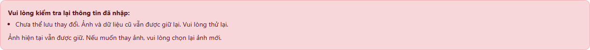

# TV3-04 — Minh chứng upload HTTP và rollback toàn luồng

Kiểm tra ngày **07/11/2026**, sau nhận xét TV3-04 của leader trên PR #38. Code nghiệp vụ được kiểm tra ở commit `ff2a536d1a3ebbed319f51c866a089fef69ea6b3`; các file Place tương ứng không khác bản đã merge vào `main` tại `476343a6de71b6bc5635702f64ff8f66573d8450`.

**Kết quả: 30/30 kiểm tra đạt.** Không phát hiện lỗi cần sửa trong code nghiệp vụ ở phạm vi này. Không thêm schema/routine. Kết quả từng ca và hash source nằm trong [TV3-04-upload-results.json](TV3-04-upload-results.json).

## Cách kiểm tra

- PHP **8.4.27**, Chrome headless, MariaDB local. Dùng bản sao source từ Git, DB clone, session và thư mục upload riêng ngoài repository.
- Request đi qua `public/index.php` → Router → `PlaceController::store/saveEditedPlace` → các Model thật. Ảnh gửi bằng multipart HTTP, không gọi helper upload trực tiếp từ CLI, không tắt `is_uploaded_file`/MIME/DB validation.
- Browser thật gửi form tạo/sửa và xác minh thông báo lỗi, ảnh cũ, khả năng gửi lại. Các ca API multipart khác cũng gọi đúng route ứng dụng.
- SHA-256 của 11 file nghiệp vụ/view/JS/entry point trong bản thử khớp workspace sau chuẩn hóa xuống dòng LF. Chỉ bootstrap của bản thử nạp bộ gây lỗi/ghi nhận I/O riêng; Controller, Model, View, route và validation không bị sửa.

## Ca còn thiếu: lỗi ngay khi lưu file thứ hai

Đã chạy qua **cả `POST places/store` và `POST places/update`**, thêm một lượt bằng giao diện Chrome:

1. Gửi ba ảnh WebP thật bằng multipart. File tạm đều được PHP nhận là HTTP upload và đã qua bước kiểm tra MIME/cấu trúc ảnh.
2. File thứ nhất gọi `move_uploaded_file` thật thành công; file đích tồn tại trong transaction đang mở.
3. Bộ gây lỗi chỉ nằm trong bootstrap thử dùng hàm cùng namespace tại ranh giới I/O: trước lần move thứ hai, xóa đúng file tạm thứ hai trong `upload_tmp_dir` riêng, rồi vẫn gọi `move_uploaded_file` gốc với tham số gốc. Hàm PHP thật trả `false` vì file tạm đã mất; không giả lập kết quả trả về bằng `return false` và không thêm hook vào source sản phẩm.
4. Model dọn file thứ nhất đã lưu. Controller bắt lỗi và rollback transaction. Kết quả tạo mới không để lại Place/ảnh/tag/file; kết quả sửa giữ nguyên toàn bộ record, ảnh/tag và hash các file cũ.

Quan sát trực tiếp ở ca sửa:

| Sự kiện | HTTP upload thật | Kết quả | Trong transaction |
|---|---|---|---|
| Move file #1 | Có | Thành công, file đích tồn tại | Có |
| Move file #2 sau khi file tạm bị mất | Có trước khi gây lỗi | Hàm PHP thật thất bại, không có file đích | Có |
| Dọn file #1 vừa tạo | — | Thành công | Có |
| Controller trả lỗi và DB rollback | — | HTTP 500; dữ liệu/file cũ giữ nguyên | Đã rollback khi request kết thúc |

Trên Chrome, form sửa trả thông báo: “Chưa thể lưu thay đổi. Ảnh và dữ liệu cũ vẫn được giữ lại. Vui lòng thử lại.” Cả ba ảnh cũ vẫn hiện. Chọn lại một ảnh và gửi lại thành công, HTTP 303, lưu đúng bộ ảnh mới.

Đây là ca lỗi I/O do file tạm biến mất giữa lúc xử lý, không phải thử ổ đĩa vật lý đầy hoặc mất điện. Nó xác minh nhánh lỗi khi move file thứ hai trong luồng Controller thật.

## Các kiểm tra còn lại theo yêu cầu review

| Nhóm | Kết quả |
|---|---|
| Tạo với 1/3 ảnh × 0/5 nhãn active | PENDING, đúng owner session, thứ tự ảnh đúng, byte file khớp ảnh gửi |
| Nhãn trùng | Chuẩn hóa còn tối đa 5 quan hệ distinct |
| 0/4 ảnh, 6 nhãn distinct, nhãn inactive, MIME giả | Từ chối, không thêm DB hoặc file dở dang |
| Guest/Admin, CSRF sai, giả owner/status/cờ bypass | Bị chặn trước khi move file |
| Sửa thay bằng 1 ảnh hoặc 3 ảnh | File cũ còn trong mọi lần move file mới; chỉ bị xóa khi transaction đã commit |
| DB lỗi tại insert ảnh thứ hai, ở cả tạo/sửa | Rollback DB, dọn toàn bộ ba file mới, giữ dữ liệu/file cũ khi sửa |
| DB lỗi khi gắn tag, ở cả tạo/sửa | Tương tự; không còn file hoặc bản ghi mồ côi |
| Duyệt bài rồi Guest xem Detail | Ảnh mới có trong HTML, từng URL ảnh trả HTTP 200 |
| Chrome gửi form tạo với 3 ảnh/5 nhãn | Lưu thành công qua route thật và chuyển My Places |

## Cách ly dữ liệu và dọn môi trường

Trước/sau kiểm thử đã đối chiếu **số dòng và hash nội dung mọi bảng DB chính**, không chỉ đếm bản ghi: đều giữ nguyên. DB thử đã xóa, session thử đã hủy, server thử đã dừng. Script, dependency, cấu hình thử và snapshot được dọn sau khi dùng; chỉ giữ báo cáo, kết quả và ảnh minh chứng. Không commit cấu hình DB/app riêng, token/session, file tải lên hoặc công cụ test.

Phần upload T04 không bị chặn bởi API phường/xã C03; các ca thành công dùng ward/tọa độ trống hợp lệ. Báo cáo này cung cấp minh chứng cho reviewer kiểm tra và đóng nhận xét full-flow còn mở, không tự thay đổi trạng thái task/checklist trên board.
