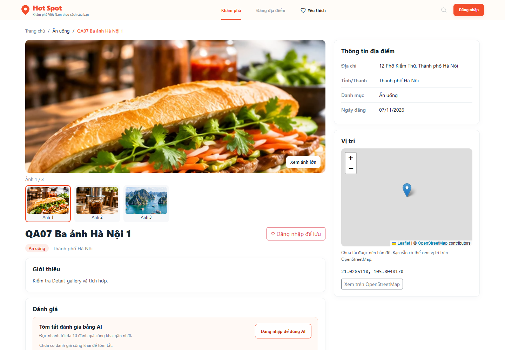
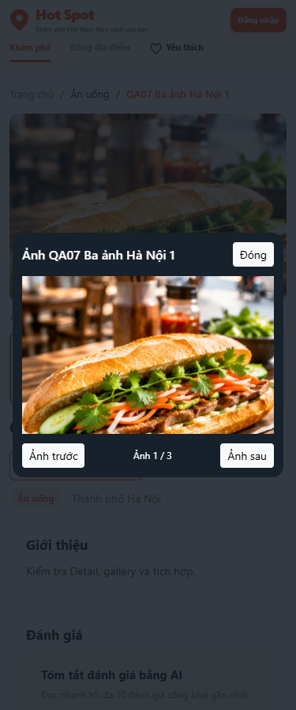
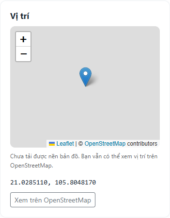

# TV3-07 — Sửa góp ý code và kiểm tra gallery/bản đồ

Kiểm tra ngày **07/11/2026**, theo nhận xét TV3-07 trên PR #38. Bản sửa dựa trên `f69f8ac`; SHA-256 từng file nghiệp vụ sau sửa được ghi trong [TV3-07-gallery-map-results.json](TV3-07-gallery-map-results.json).

## Thay đổi code

- Thay `pair ? 16 : 5` trong `public/assets/js/map.js` bằng biến `initialCenter`, `initialZoom` và `if` tường minh. Không còn toán tử ternary trong file này.
- Không có tọa độ: giữ tâm mặc định và zoom 5, không tạo marker hay tự điền tọa độ. Có tọa độ: dùng cặp đã lưu và zoom 16.
- Tăng phiên bản script ở cả View Detail và form, vì T07/T08 dùng chung `map.js`.

## Kết quả

**37/37 kiểm tra đạt** bằng Chrome headless trên ứng dụng PHP thật, DB/session/upload thử riêng. PHP **8.4.27**, Leaflet **1.9.4** của dự án. File Controller/Model/View/JS trong bản thử khớp workspace qua SHA-256 sau chuẩn hóa CRLF thành LF; không thay nghiệp vụ bằng mock. PHP/JS syntax và `git diff --check` đạt.

| Phạm vi review | Đã kiểm tra |
|---|---|
| Gallery 1/3 ảnh | Ảnh upload thật, đúng thứ tự; thumbnail đổi ảnh/counter/trạng thái; một ảnh vô hiệu hóa trước/sau |
| Dialog/bàn phím | Mở ảnh lớn, trước/sau có vòng, phím mũi tên, Escape, nút Đóng, click nền; native modal chặn focus nền và trả focus về nút mở |
| Ảnh thiếu | Xóa file ảnh thực trong thư mục thử: ảnh chính và dialog dùng fallback; mất cả fallback hiện thông báo có giới hạn, không lặp tải vô hạn; không có record ảnh vẫn hiện fallback |
| Tọa độ | Marker đúng tọa độ đã lưu; NULL/thiếu một giá trị/0,0/vượt phạm vi không dựng map hay nạp Leaflet. Cặp có một giá trị 0 hợp lệ vẫn dùng được |
| Leaflet | Marker asset cục bộ, popup text an toàn, attribution/link vị trí/zoom hoạt động; scroll wheel zoom tắt; mobile chỉ khởi tạo khi gần viewport, không khởi tạo trùng |
| Lỗi mạng/thư viện | Tile 503 giữ marker, link và thông báo; chặn Leaflet vẫn dùng gallery/Detail/link. Tắt JS vẫn đọc Detail, xem ảnh gốc và dùng link vị trí |
| Desktop/mobile | 1440/768/375px, tiêu đề có HTML và chuỗi dài; không tràn ngang, dialog vừa viewport, không thực thi HTML trong heading/dialog/popup |
| Phân quyền | Guest/member khác không xem bài PENDING; owner/Admin được xem, không lộ Favorite/Review/AI ở bài private |
| Favorite/Review/AI | Khi file ảnh mất và tile 503: script mỗi loại nạp một lần, đúng place ID/CSRF; Favorite thêm/bỏ và reload, Review gửi bằng AJAX lưu vào DB; AI dùng endpoint/cache thật, hiển thị text; lỗi mạng mở lại nút; HIDDEN không lộ ở Guest hoặc AI |
| Hồi quy T08 | Form trống zoom 5/no marker/không tự điền tọa độ; form sửa có geo zoom 16/marker đúng; xóa tọa độ bỏ marker và xóa cả hai trường |

Không có uncaught JS error trong các tương tác chính.

## Giới hạn xác minh tile trực tuyến

Ở các ca tương tác, chỉ response ảnh tile được thay bằng SVG lưới có nhãn **QA tile (mock)**, hoặc cố ý trả HTTP 503. Leaflet, marker, popup, zoom, các form Favorite/Review/AI, Controller và DB đều chạy code thật. AI được kiểm tra bằng cache thử; không gọi Claude thật.

Một browser context riêng **không mock tile** đã thử OpenStreetMap thật. Kết quả: **0 tile tải được**, lỗi `net::ERR_NAME_NOT_RESOLVED`. Vì vậy kết quả 37/37 xác nhận ứng dụng và fallback khi mạng lỗi, không khẳng định nền bản đồ trực tuyến đã tải thành công. Cần kiểm lại nền tile tại môi trường phân giải DNS được.

Ảnh bên dưới chụp từ context không mock tile, thể hiện đúng tình trạng mạng thật của máy:

## Cách ly và dọn môi trường

Toàn bộ ghi dữ liệu kiểm thử diễn ra trên DB clone và snapshot riêng ngoài repo. Đối chiếu số dòng **và hash nội dung mọi bảng DB chính** trước/sau: không đổi. DB thử đã xóa, session thử đã hủy, server thử dừng. Script/dependency/snapshot/cấu hình thử được dọn sau kiểm tra; chỉ giữ báo cáo, JSON kết quả và ảnh minh chứng. Không commit config DB/app riêng, token, dữ liệu upload hoặc công cụ test.

Báo cáo cung cấp minh chứng để reviewer kiểm tra và đóng góp ý TV3-07; không tự cập nhật task/checklist, không phụ thuộc API wards C03 và không thay module Favorite/Review/AI của người khác.
