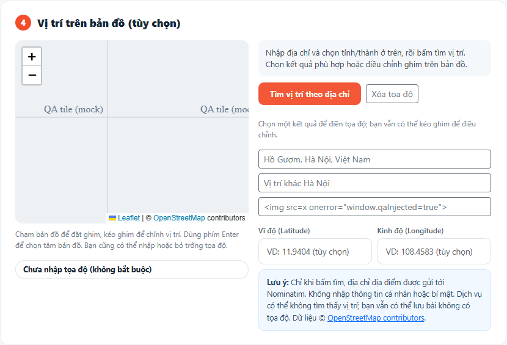
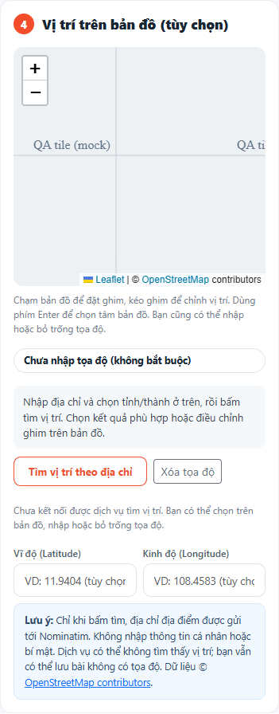

# TV3-08 — Sửa quy ước và kiểm tra geocoding tùy chọn

Kiểm tra ngày **07/11/2026**, theo góp ý TV3-08 trên PR #38. Bản sửa dựa trên `13918dd`; SHA-256 từng file sau sửa được ghi trong [TV3-08-geocoding-results.json](TV3-08-geocoding-results.json).

## Thay đổi

- Thay ternary còn lại trong phần xử lý timeout/lỗi của `place-form.js` bằng biến `errorMessage` và `if` tường minh. Giữ nguyên nội dung thông báo, cách bỏ kết quả cũ và việc mở lại nút tìm.
- Tăng phiên bản script trong form để trình duyệt tải bản mới. `map.js` đã sửa theo góp ý ở T07.
- Phân tích AST xác nhận cả `place-form.js` và `map.js` có **0 `ConditionalExpression`**; không nhầm dấu `?` trong chuỗi URL với ternary.

## Kết quả kiểm tra

**40/40 ca đạt** trên PHP **8.4.27**, Chrome headless, hai tiến trình PHP và DB/session/upload thử riêng. File nghiệp vụ trong snapshot khớp workspace qua SHA-256 sau chuẩn hóa xuống dòng LF. PHP/JS syntax và diff check đạt.

| Yêu cầu review | Minh chứng đã chạy |
|---|---|
| Success | Browser bấm tìm qua endpoint PHP thật; cURL HTTPS nhận ba kết quả từ dịch vụ thử; không tự điền trước khi chọn; chọn xong điền đúng cặp tọa độ và marker |
| Empty | Upstream trả `[]`, API thành công với danh sách rỗng, browser hiện thông báo; không xóa tọa độ hợp lệ đang có và không khóa lưu |
| Timeout PHP | Upstream giữ kết nối: cURL dừng khoảng 5 giây, trả lỗi an toàn, nhả khóa; thử cả qua API và trình duyệt |
| Timeout browser | Giữ request ở ranh giới mạng browser trên 8 giây: AbortController chạy, hiển thị đúng nhánh thông báo mới và mở lại nút tìm |
| Offline | Browser mất mạng được báo lỗi và mở lại nút. Sau phục hồi kết nối, lưu qua Controller thành PENDING, DB nhận NULL/NULL. Khi chỉ request geocoding bị lỗi, việc POST lưu bài vẫn hoạt động |
| Chọn/kéo ghim | Chọn kết quả, kéo marker bằng chuột, click bản đồ, nhập tay, xóa tọa độ; marker và hai trường được đồng bộ |
| Kết quả cũ | Đổi địa chỉ, đổi tỉnh, chọn điểm trên map hoặc xóa tọa độ khi đang chờ phản hồi chậm: không áp kết quả cũ, không khôi phục tọa độ vừa xóa; đổi tỉnh reset ward |
| Sửa bài | Form sửa tìm/chọn rồi lưu đúng tọa độ mới; xóa cả hai và lưu lại thành NULL/NULL, không cần tải lại ảnh |
| Quyền/đầu vào | Guest/Admin, CSRF sai, phương thức sai, địa chỉ/tỉnh sai và truyền URL upstream từ request bị chặn trước khi gọi dịch vụ |
| Cache/giới hạn | Truy vấn chuẩn hóa dùng cache chung giữa hai member; kết quả rỗng có cache; hai tiến trình không gọi upstream đồng thời; truy vấn nhanh trả 429/Retry-After; 19 request quan sát cách nhau ít nhất 1 giây |
| Gửi bài khi tìm chậm | API nhả session lock trước cURL; cùng member gửi bài qua tiến trình thứ hai thành công khi tìm vị trí còn đang chạy, tọa độ lưu NULL |
| Lỗi cache/upstream | Mô phỏng đường dẫn file khóa không mở được bằng filesystem thật: 503, không gọi upstream, browser vẫn lưu NULL/NULL; khôi phục đường dẫn thì tìm được. JSON sai/HTTP 500/429 không retry tự động |
| Giao diện | 1440/768/375px không tràn ngang; không có uncaught JS error; tắt JS vẫn có hai trường tọa độ tùy chọn và nút gửi |

## Kết nối Nominatim thật

Một lượt tìm **Hồ Gươm** được gửi qua endpoint ứng dụng với nhà cung cấp mặc định `https://nominatim.openstreetmap.org/search`, không mock Nominatim. cURL gốc vẫn kiểm tra chứng chỉ TLS.

- Transport: **HTTP upstream 0, cURL errno 6**, `Could not resolve host: nominatim.openstreetmap.org`.
- Endpoint ứng dụng trả **HTTP 503**; browser không có kết quả, không tự điền tọa độ và vẫn cho lưu.
- Thông báo thực tế: “Chưa kết nối được dịch vụ tìm vị trí. Bạn có thể chọn trên bản đồ, nhập hoặc bỏ trống tọa độ.”

Do đó chưa xác minh được **success từ Nominatim công cộng trên mạng hiện tại**. Kết quả 40/40 xác nhận luồng ứng dụng với HTTPS thử nghiệm và cách xử lý lỗi thật, không khẳng định dịch vụ công cộng đã trả được tọa độ. Cần kiểm lại tại môi trường phân giải DNS được; lượt kiểm tra này không đổi DNS hệ thống.

## Quyền cache

Đã chạy probe HTTP bằng **PHP của Apache/XAMPP thật** (`apache2handler`) trên thư mục `storage/cache/geocoding` của workspace: thư mục khả dụng, ghi/đọc/khóa độc quyền đều thành công và file probe được dọn. File PHP probe trong `public/` cũng đã xóa ngay sau kiểm tra.

Kết quả này áp dụng cho máy hiện tại. Khi deploy sang hosting, cần lặp kiểm tra đọc/ghi/khóa/xóa bằng đúng user PHP của hosting và bảo đảm thư mục cache ngoài web root có quyền ghi; không coi phép thử local là đã kiểm chứng quyền hosting.

## Phạm vi dữ liệu thử

Success/empty/timeout dùng server **HTTPS thử nghiệm cục bộ** với schema response Nominatim. PHP vẫn gọi cURL thật qua HTTPS. Bootstrap chỉ trong snapshot thêm CA của chứng chỉ thử cho host localhost và ghi chẩn đoán transport; không tắt TLS hay mock `curl_exec`. Bật provider mặc định cho lượt gọi Nominatim thật. Code Controller/Service/View/JS sản phẩm giữ đúng bản đã hash.

Response ảnh tile của Leaflet được mock bằng SVG có nhãn **QA tile (mock)**, không phải bản đồ địa lý thật. Không thêm API wards của TV2; C03 vẫn tùy chọn. Không gọi AI, không dùng quota Claude.

Toàn bộ ghi DB diễn ra trên bản clone. Số dòng và hash nội dung mọi bảng DB chính trước/sau đều không đổi; DB thử đã xóa, session thử hủy và server thử dừng. Công cụ/dependency/snapshot/chứng chỉ/cấu hình thử được dọn; chỉ giữ báo cáo, JSON và ảnh minh chứng. Không commit file kết nối DB/app riêng, token, cache, chứng chỉ hoặc script test.

Báo cáo để reviewer đối chiếu và nghiệm thu; không tự đổi trạng thái task/checklist, không tạo PR hoặc merge vào main.
