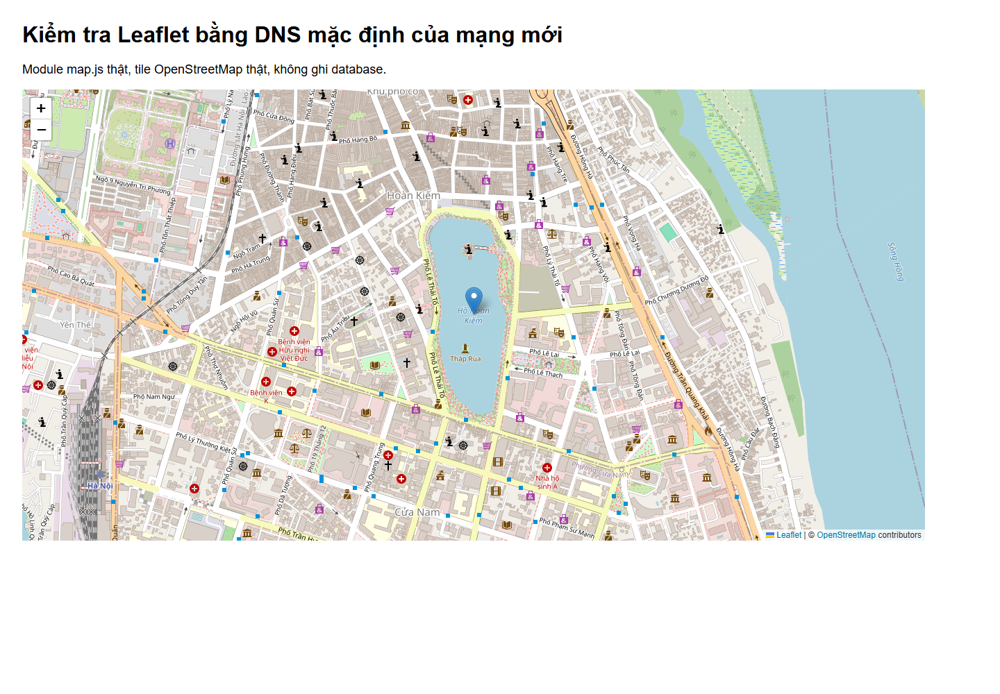
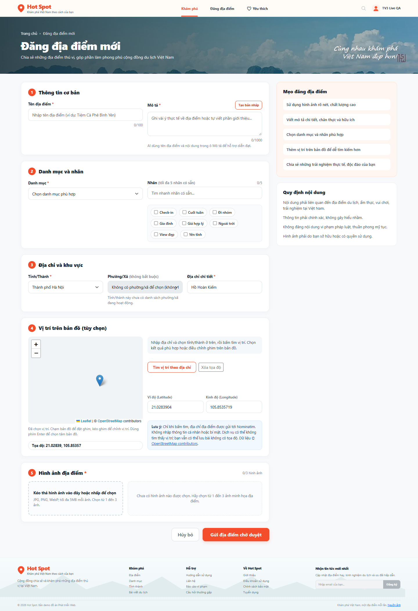

# TV3-08 — Kiểm chứng Nominatim thật và nguyên nhân DNS

Kiểm tra ngày **07/11/2026**, source `10b2cbb`, theo góp ý leader trên TV3-08. SHA-256 và kết quả chi tiết nằm trong [TV3-08-live-network-results.json](TV3-08-live-network-results.json).

## Cập nhật sau khi Thành đổi mạng

Kiểm tra lại trên source `4cca6d4` (các file nghiệp vụ giữ nguyên SHA-256): **đã gỡ blocker DNS local**. Các phần mô tả lỗi DNS và cấu hình QA bên dưới là lịch sử của mạng cũ.

- DNS mặc định trên mạng mới phân giải được Nominatim và tile OSM. PHP cURL truy cập hai host đều HTTP 200, errno 0, giữ xác minh TLS, không cấu hình resolver riêng.
- Service `PlaceGeocoder` thật chạy bằng **Apache `apache2handler`** trên workspace nhận HTTP 200 và trả đúng Hồ Hoàn Kiếm `21.0288313, 105.8525357`. Cache chưa có trước lượt gọi; sau đó file cache được tạo, nội dung khớp response và gọi lặp dùng cache.
- PHP Apache kiểm tra ghi/đọc/khóa/xóa file cache đều đạt trên mạng mới.
- Chrome headless dùng DNS mặc định tải **24 tile OSM thật** qua module `map.js` sản phẩm trên trang kiểm tra module cục bộ. Không thay resolver, không mock tile; đây không phải lần chạy lại toàn bộ form/upload. Bằng chứng đầy đủ chọn kết quả/kéo ghim/lưu bài nằm ở lượt QA trước trong báo cáo này.
- Không thay cấu hình DNS của máy, không tắt TLS và không ghi database. Các probe HTTP, trang kiểm tra và profile Chrome tạm đã được dọn. Không còn cần lệnh đổi DNS Administrator trên mạng mới.

TV3-08 hiện chỉ còn điều kiện triển khai: kiểm quyền cache bằng đúng user PHP của hosting khi có môi trường hosting. Không tự đổi trạng thái review/board.



## Kết quả thực tế

Đã chạy Chrome headless với form, Router, Controller, Service và upload thật trên snapshot khớp source workspace. Database thử sao chép 15 bảng và 18 routine, tài khoản/session/upload riêng.

- **10/10 kiểm tra với nhà cung cấp công cộng đạt**: Nominatim trả HTTP 200, chọn kết quả mới điền tọa độ, kéo ghim cập nhật hai trường, multipart lưu thành PENDING, tìm không có kết quả, cache và giao diện 375px.
- Kết quả Hồ Hoàn Kiếm được chọn: `21.0288313, 105.8525357`. Sau thao tác kéo ghim bằng chuột: `21.0283904, 105.8535719`. Database QA lưu đúng cặp tọa độ sau kéo, trạng thái `PENDING`.
- **6 tile OpenStreetMap thật tải HTTP 200**; không dùng ảnh tile giả. Nominatim/TLS và response provider cũng không mock.
- Hai lần gọi upstream thật qua Service (tìm có kết quả và tìm rỗng) tuân thủ khoảng cách trên một giây. Tìm lặp lại dùng cache, không gọi upstream thêm.
- **8/8 kiểm tra Chrome với ranh giới mạng có kiểm soát đạt**: script tích hợp, empty, timeout trình duyệt 8 giây, đổi địa chỉ lúc chờ, offline, xóa tọa độ, phục hồi mạng rồi multipart lưu NULL/NULL và không có lỗi JavaScript chưa xử lý. Không gọi các response có kiểm soát này là response thật từ Nominatim.
- Đối chiếu mọi bảng database chính trước/sau: số dòng và SHA-256 của **15/15 bảng không đổi**. Hai phép đối chiếu riêng xác nhận bài sau offline lưu NULL/NULL và bài từ Nominatim lưu đúng tọa độ kéo.

## Phạm vi DNS của phép thử trước khi đổi mạng

DNS mặc định của Wi-Fi (`192.168.1.1`, `123.26.26.26`) trả NXDOMAIN cho cả Nominatim và tile OSM; xóa cache DNS không giải quyết được. Cùng thời điểm, hai resolver `1.1.1.1` và `8.8.8.8` đều trả địa chỉ hợp lệ, kiểm tra DNS-over-HTTPS cũng có kết quả.

Để kiểm chứng dịch vụ thật mà không thay hệ thống, **chỉ trong runtime QA**, cURL và Chrome sử dụng địa chỉ vừa lấy từ DNS công cộng. URL, hostname/SNI, kiểm tra chứng chỉ TLS và source sản phẩm được giữ nguyên; không hard-code IP hoặc thêm resolver dự phòng vào code được commit. File bootstrap QA chỉ cấu hình phân giải cURL, không giả `curl_exec` hay nội dung trả về.

Vì vậy bằng chứng này xác nhận luồng ứng dụng chạy được với Nominatim/OSM thật trong môi trường phân giải được DNS. **Không khẳng định DNS mặc định của máy đã được sửa**. Phiên Codex hiện không có quyền Administrator để đổi DNS adapter; cấu hình DHCP cũ đã được sao lưu ngoài repository.

Sửa môi trường máy Thành cần PowerShell Administrator:

```powershell
Set-DnsClientServerAddress -InterfaceIndex 2 -ServerAddresses 1.1.1.1,8.8.8.8
Clear-DnsClientCache
```

Sau đó thử lại bằng DNS mặc định, PHP Apache và trình duyệt thông thường. Lệnh khôi phục DNS do DHCP cấp trên Wi-Fi hiện tại:

```powershell
Set-DnsClientServerAddress -InterfaceIndex 2 -ResetServerAddresses
Clear-DnsClientCache
```

InterfaceIndex 2 áp dụng cho Wi-Fi máy Thành tại thời điểm kiểm tra, không áp dụng mặc định cho máy khác/hosting.

## Quyền cache và phần còn chờ

Probe HTTP bằng **PHP Apache `apache2handler` thật** trên `storage/cache/geocoding`: thư mục, ghi, đọc, `flock` độc quyền và xóa file đều đạt. Probe công khai và file dữ liệu probe đã được xóa ngay sau kiểm tra. Đối với hosting, vẫn phải chạy kiểm tra bằng đúng user PHP của hosting; lượt này không có môi trường hosting để nghiệm thu.

Tại lượt QA trước khi đổi mạng, còn hai điều kiện môi trường: DNS mặc định của máy và quyền cache ở hosting. Cập nhật đầu báo cáo đã xác nhận DNS local hoạt động sau đổi mạng; hosting vẫn chưa có môi trường để kiểm tra. Code TV3 không cần thay nhà cung cấp hoặc tắt kiểm tra TLS để né lỗi DNS. Chưa tự đóng review hay đổi trạng thái task.

Sau kiểm tra đã dừng server QA, xóa database thử, dọn script test, dependency, session, snapshot và cấu hình riêng. Chỉ giữ báo cáo/JSON/ảnh minh chứng; `vendor` thật của dự án được giữ nguyên. Không đưa cấu hình database/app hay bản sao DNS vào Git.




